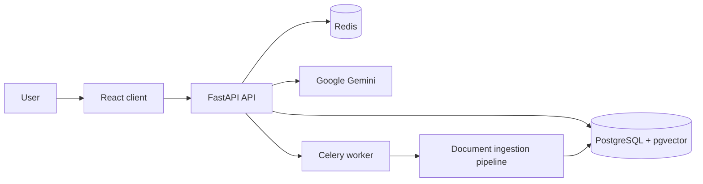

# AI Knowledge Agent Platform

A production-style multi-tenant AI knowledge base platform built with FastAPI, React, PostgreSQL + pgvector, Redis, Celery, and LangChain/LangGraph. It allows organizations to sign up, upload PDFs, index them into a vector store, ask questions over the stored knowledge, and chat with a retrieval-aware agent backed by Google Gemini.

## What this project includes

- Multi-tenant authentication and authorization
- Organization-level membership and admin access
- PDF upload and async document ingestion
- pgvector-based semantic search over chunks
- RAG-style question answering with citations
- LangGraph-powered knowledge agent with tool-based retrieval
- Conversation history per organization
- Admin dashboard for member and usage insights
- Dockerized local setup and Render deployment config

## Tech stack

- Backend: FastAPI, Python 3.11
- Frontend: React + Vite
- Database: PostgreSQL + pgvector
- Cache/queue: Redis + Celery
- AI: LangChain, LangGraph, Google Gemini
- Deployment: Docker Compose for local dev, Render config included

## Architecture at a glance



Core request flows:

- `POST /signup` and `POST /login` handle auth and tenant membership
- `POST /documents` uploads a PDF and enqueues async processing
- `POST /query` runs retrieval-augmented generation over embedded PDF chunks
- `POST /agent` runs the LangGraph knowledge agent with document search tools
- `GET /org/*` serves admin/organization-level data
- `GET /conversations/*` manages chat history

## Repository structure

```text
.
├── app/
│   ├── api/                 # FastAPI routes and auth dependencies
│   ├── core/                # security and shared app utilities
│   └── services/            # Celery, document pipeline, retrieval, agent logic
├── client/                  # React + Vite frontend
├── db/                      # database connection + SQL schema/bootstrap
├── docs/                    # architecture and pipeline notes
├── experiments/             # prototype / learning scripts
├── uploaded_docs/           # local uploaded PDF storage
├── .env.example             # environment template
├── docker-compose.yml       # local stack (db, redis, app, worker, client)
├── Dockerfile.backend       # backend container image
├── render.yaml              # Render deployment config
├── requirements.txt         # Python dependencies
├── start.sh                 # backend entrypoint
├── package.json             # root package metadata (mostly deployment-related)
├── README.md                # project documentation
└── tests/                   # project validation scripts
```

## Prerequisites

Before running locally, make sure you have:

- Python 3.11+
- Node.js 18+ and npm
- Docker Desktop or Docker Engine
- A Google AI API key for Gemini

## Environment configuration

Copy the example environment file and customize it:

```bash
cp .env.example .env
```

The most important variables are:

- `DATABASE_URL` — PostgreSQL connection string
- `REDIS_URL` — Redis connection string
- `JWT_SECRET_KEY` — secret used for JWT signing
- `GOOGLE_API_KEY` — API key for Gemini
- `GEMINI_MODEL` — model name, default is `gemini-2.5-flash`
- `CORS_ORIGINS` — allowed frontend origins
- `VITE_API_URL` — frontend backend base URL

Important note: this project expects external services for Postgres and Redis in production. The local Compose stack provisions them, while Render config expects managed services like Neon and Upstash to be configured separately.

## Run locally

### 1) Create a virtual environment

```bash
python -m venv venv
source venv/bin/activate
# Windows PowerShell:
# .\venv\Scripts\Activate.ps1
# Windows CMD:
# venv\Scripts\activate
```

### 2) Install Python dependencies

```bash
pip install -r requirements.txt
```

### 3) Start infrastructure services

```bash
docker compose up -d
```

This starts:

- PostgreSQL with pgvector
- Redis
- FastAPI app container
- Celery worker
- React client container

### 4) Start the backend manually (if needed)

```bash
uvicorn app.main:app --reload --host 0.0.0.0 --port 8000
```

### 5) Start the Celery worker (if not using the Compose worker)

```bash
celery -A app.services.celery_app.celery_app worker --loglevel=info --concurrency=2
```

### 6) Start the frontend

```bash
cd client
npm install
npm run dev
```

The app should be available at:

- Frontend: http://localhost:5173 or the configured Vite host
- API: http://localhost:8000
- Health check: http://localhost:8000/health

## Production deployment

This repository includes a Render deployment configuration in [render.yaml](render.yaml). It is designed for:

- a Dockerized backend service
- a static frontend build for the React client
- environment variables supplied through the Render dashboard

The app is set up for a typical render deployment layout, but keep in mind the current design stores uploaded PDFs in the local `uploaded_docs` directory. That is fine for a single-instance app or local dev, but for multi-instance production deployment you should move uploaded files to shared object storage such as S3, R2, or a similar durable store.

## API overview

### Authentication

- `POST /signup` — create an org and admin user, or join an org via invite code
- `POST /login` — perform JWT login

### Documents

- `POST /documents` — upload and queue a PDF for ingestion
- `GET /documents` — list uploaded docs for the current org
- `GET /documents/{document_id}` — fetch metadata for a single document

### Chat and knowledge retrieval

- `POST /query` — retrieve relevant chunks and answer a question
- `POST /agent` — run the LangGraph agent and return an answer with citations
- `GET /conversations` — list conversations
- `GET /conversations/{conversation_id}` — load a thread
- `POST /conversations` — create a conversation thread

### Admin

- `GET /org/members` — list organization members
- `GET /org/usage` — return document and query counts
- `GET /org/invite` — return the invite code for the org

## Notes and caveats

- The project uses JWT-based org scoping and supports admin/member roles.
- Document processing is asynchronous through Celery, and ingestion happens outside the API request lifecycle.
- PDF files are stored on disk in `uploaded_docs` for the current instance.
- For production scaling, a shared storage layer and stronger monitoring/logging would be the next major improvements.
- The current frontend is already functional and polished enough for a usable product, but there are still opportunities for optimization and hardening later.

## Suggested next steps

1. Add production-grade object storage for uploads
2. Add structured logging and monitoring
3. Add automated tests for auth, ingestion, and retrieval flows
4. Improve environment validation and startup checks
5. Add CI/CD pipelines and deployment health checks

