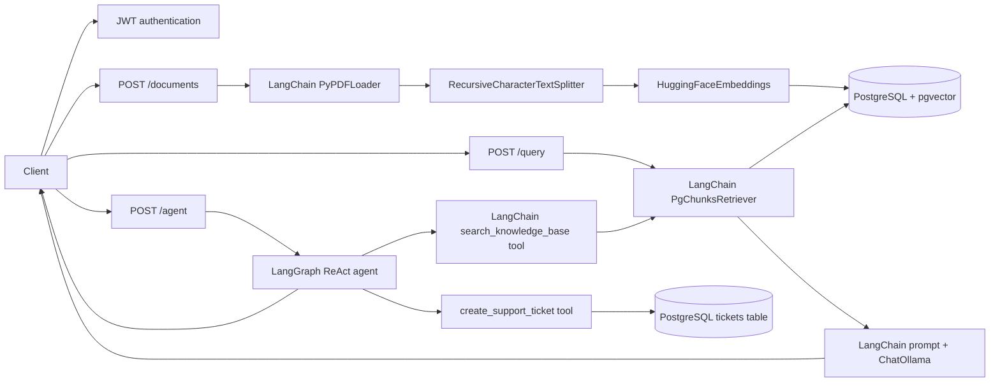

# Architecture

## Runtime Components

- FastAPI exposes authentication, document ingestion, the LangChain RAG query, ticket endpoints, and the LangGraph agent.
- PostgreSQL with pgvector stores document metadata, chunks, and support tickets.
- LangChain provides PDF loading, text splitting, embeddings, retrieval, prompts, tools, and model integration.
- LangGraph provides the agent graph and tool execution loop with both retrieval and support-ticket tools.

## Request Paths

## Boundaries

- `app/api/` contains HTTP contracts and authentication dependencies.
- `app/services/langchain_ingest.py` owns framework-based PDF ingestion.
- `app/services/langchain_retriever.py` adapts the application-owned pgvector schema to LangChain's retriever interface.
- `app/services/langgraph_agent.py` owns the LangGraph agent and its tool set: search and ticket creation.
- `app/services/ticket_service.py` owns ticket validation and persistence in PostgreSQL.
- `app/services/document_store.py` owns persistence of documents and chunks.
- `db/` owns the connection helper, schema, and migration history.

The application keeps the RAG path (`/query`) and adds a ticket path that is scoped to the authenticated organization. Raw RAG orchestration and manual agent loops are not part of the runtime architecture.

## Product / UI Layer

Phase 4 adds a React/Vite client in `client/` for the end-to-end authenticated workflow.

### Auth Flow

- `LoginPage` submits username and password to `POST /login`.
- `SignupPage` supports either creating an organization with `org_name` or joining an existing organization with `invite_code`, matching the FastAPI signup contract. A successful signup logs in immediately.
- `AuthProvider` stores the JWT in React context memory only; it does not use `localStorage`. It decodes the token for username, `user_id`, `org_id`, and `role`.
- `ProtectedRoute` redirects unauthenticated users to `/login` and wraps the authenticated application routes.

### Document Upload UI

`DocumentsPage` loads the organization-scoped document list with `GET /documents`. Users choose a PDF and submit it as multipart form data to `POST /documents`. Because ingestion is synchronous in the backend, the UI shows local `processing` feedback while the request is in flight, then marks the document ready and refetches the list after a successful response. Upload errors are shown inline and as a toast.

### Chat UI

`ChatPage` loads the user's conversation list with `GET /conversations`, opens threads with `GET /conversations/{id}`, and creates empty threads with `POST /conversations`. The sidebar supports selecting existing threads or starting a new one.

Messages are sent to `POST /agent` with the active `conversation_id` when one exists. The UI adds the user message optimistically, shows a typing indicator while the request is pending, then reloads the conversation to display the persisted assistant response and citations. Citation chips show the document filename and page; clicking one opens a modal with that source name and page. The current API does not return chunk text in citation metadata, so the modal does not display source text.

### Admin Panel

`AdminPage` is available at `/admin` only for users whose JWT role is `admin`. The sidebar hides the Admin link for members, and `AdminRoute` redirects members who navigate to `/admin` directly.

The panel loads:

- Organization members from `GET /org/members`.
- Document and query counts from `GET /org/usage`.
- The organization invite code from `GET /org/invite`, with a copy button for sharing it with new members.

### Polish States

The client uses local loading states and an admin skeleton while GET requests are in flight. Empty document and conversation lists have explicit next-step messages. A small custom `ToastProvider` displays timed error or success notifications for failed API calls and actions across auth, upload, chat, and admin screens; no toast library is used.

Phase 4 complete — app is a usable end-to-end product (auth, upload, chat, admin) as of v0.2-product-ui.
