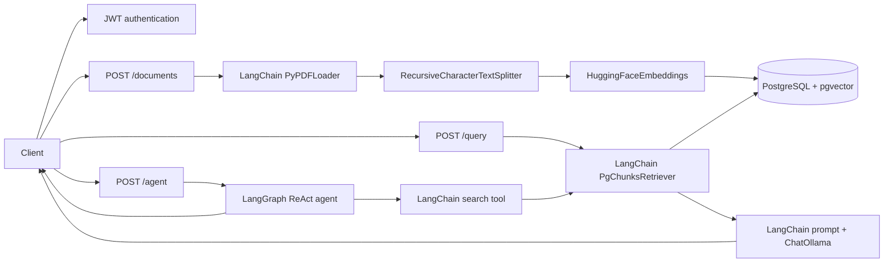

# Architecture

## Runtime Components

- FastAPI exposes authentication, document ingestion, the LangChain RAG query, and the LangGraph agent.
- PostgreSQL with pgvector stores document metadata, chunks, and 384-dimensional embeddings.
- Ollama serves the local `llama3.2` chat model.
- LangChain provides PDF loading, text splitting, embeddings, retrieval, prompts, tools, and model integration.
- LangGraph provides the agent graph and tool execution loop.

## Request Paths

## Boundaries

- `app/api/` contains HTTP contracts and authentication dependencies.
- `app/services/langchain_ingest.py` owns framework-based PDF ingestion.
- `app/services/langchain_retriever.py` adapts the application-owned pgvector schema to LangChain's retriever interface.
- `app/services/langgraph_agent.py` owns the LangGraph agent and its LangChain retrieval tool.
- `app/services/document_store.py` owns persistence of documents and chunks.
- `db/` owns the connection helper and SQL schema.

The application has one RAG path (`/query`) and one agent path (`/agent`). Raw RAG orchestration and manual agent loops are not part of the runtime architecture.
